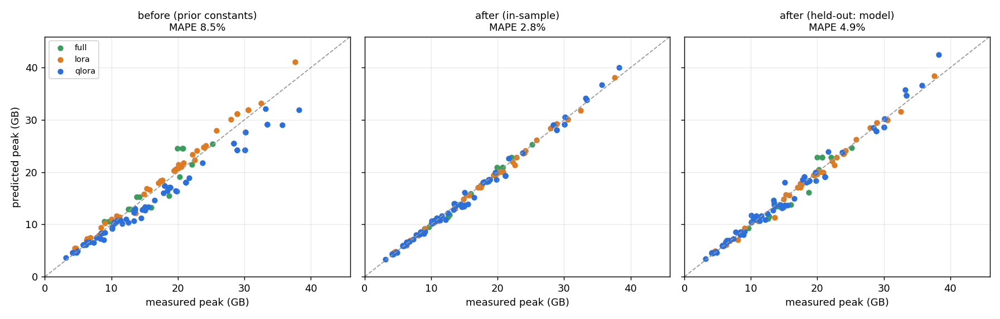

# cost model 보정 리포트 (Phase 3)

- 생성: 2026-10-21 14:50 · 데이터: `data/measurements_colab_t4.csv, data/measurements_mig.csv`
- 타깃: `device` · GPU: NVIDIA A100-SXM4-80GB MIG 3g.40gb, Tesla T4 · 모델: llama-3.1-8b, llama-3.2-1b, mistral-7b-v0.3, qwen2.5-3b, qwen2.5-7b
- 성공 140행 · OOM 31행 · λ=0.01

## 1. 예측 정확도

| 평가 | n | MAPE | median APE | max APE | 과소예측 비율 | 과소예측 p95 |
|---|---|---|---|---|---|---|
| 보정 전 (문헌 상수) | 140 | 8.5% | 7.9% | 23.2% | 54% | 20.8% |
| 보정 후 in-sample | 140 | 2.8% | 1.9% | 10.7% | 51% | 9.8% |
| 보정 후 held-out: LOO | 140 | 3.1% | 2.2% | 10.8% | 51% | 10.0% |
| 보정 후 held-out: 모델 제외 ★ | 140 | 4.9% | 3.8% | 19.9% | 49% | 11.8% |

**권장 안전계수 safety = 0.895** — held-out 과소예측 p95를 덮는 값. `fits(cfg, model, gpu_mem_gb, safety=0.895)`

## 2. OOM 판정 (예측 > GPU 용량 → OOM)

| 상수 | 정답 | 놓친 OOM (위험) | 오경보 (보수적) |
|---|---|---|---|
| 보정 전 | 164/171 | 4 | 3 |
| 보정 후 | 167/171 | 3 | 1 |
| 보정 후 + safety 0.895 | 163/171 | 0 | 8 |

## 3. 처리량(tokens/s) 보정

| GPU | n | MAPE 보정 전 | MAPE 보정 후 | eff full / lora / qlora | t_half | 범위 |
|---|---|---|---|---|---|---|
| t4 | 40 | 37.7% | 19.4% | 0.152 / 0.157 / 0.162 | 128 | ×/÷1.6 |
| a100-mig3g40 | 100 | 63.4% | 10.4% | 0.461 / 0.606 / 0.487 | 256 | ×/÷1.396 |

> 처리량 보정은 측정한 GPU에만 적용됩니다. 다른 GPU는 사전값(범위 ×/÷1.6)을 씁니다.

## 4. 보정된 메모리 상수

| 상수 | prior | default | full | lora | qlora |
|---|---|---|---|---|---|
| act_h | 25.54 | 11.08 | 19.56 | 25.15 | 21.16 |
| act_i | 6.682 | 12.63 | 5.424 | 5.52 | 12.82 |
| ckpt_h | 1.966 | 4.142 | 1.463 | 1.085 | 5.291 |
| logit_bytes | 13.66 | 13.97 | 19.54 | 14.02 | 13.77 |
| opt_temp | 2.082 | 1.277 | 0.8601 | 2.082 | 2.082 |
| attn_sq_bytes | 2 | 3.995 | 2 | 3.784 | 3.962 |
| nf4_extra | 0.016 | 0.01658 | 0.01658 | 0.01658 | 0.01658 |
| qlora_nonquant_bytes | 4 | 3.999 | 3.999 | 3.999 | 3.999 |
| overhead_gb | 1.272 | 0.739 | 1.228 | 0.4791 | 0.7874 |

> method별 열은 해당 method 행이 `--min-group` 이상일 때만 생깁니다. 그 외 method는 `default`를 씁니다.

## 5. 구성요소 검증 (측정값으로 항별 확인)

| 설정 | weights 예측 | mem_model 실측 | 오차 | weights+optim 예측 | mem_steady 실측 | 오차 |
|---|---|---|---|---|---|---|
| llama-3.2-1b/qlora adamw r16attn | 1.46 | 1.46 | +0.1% | 1.49 | - | - |
| llama-3.1-8b/qlora adamw r16attn | 7.32 | 7.32 | -0.0% | 7.42 | 7.4412 | -0.2% |
| llama-3.1-8b/lora adamw r16attn | 15.01 | 15.01 | -0.0% | 15.11 | 15.1257 | -0.1% |
| qwen2.5-7b/qlora adamw r16attn | 7.24 | 7.25 | -0.1% | 7.31 | 7.3394 | -0.3% |
| qwen2.5-7b/lora adamw r16attn | 14.23 | 14.22 | +0.1% | 14.31 | 14.3148 | -0.1% |
| llama-3.2-1b/lora adamw r16attn | 2.32 | 2.32 | +0.3% | 2.35 | 2.3568 | -0.4% |
| llama-3.2-1b/full adamw8bit r16attn | 2.31 | 2.30 | +0.3% | 4.62 | 4.6581 | -0.8% |
| llama-3.2-1b/full adamw r16attn | 2.31 | 2.30 | +0.3% | 6.93 | 6.9245 | +0.1% |
| qwen2.5-3b/qlora adamw r16attn | 2.52 | 2.53 | -0.3% | 2.58 | 2.6023 | -0.9% |
| qwen2.5-3b/full adamw8bit r16attn | 5.76 | 5.75 | +0.1% | 11.51 | 11.6965 | -1.6% |
| llama-3.1-8b/qlora adamw r8attn | 7.30 | 7.30 | -0.0% | 7.35 | 7.3651 | -0.2% |
| llama-3.1-8b/qlora adamw r8all | 7.35 | 7.35 | -0.0% | 7.51 | 7.5233 | -0.2% |
| llama-3.1-8b/qlora adamw r64attn | 7.47 | 7.48 | -0.0% | 7.88 | 7.8983 | -0.2% |
| llama-3.1-8b/qlora adamw r64all | 7.90 | 7.90 | -0.0% | 9.15 | 9.1676 | -0.2% |
| llama-3.1-8b/qlora adamw8bit r16attn | 7.32 | 7.32 | -0.0% | 7.35 | 7.3655 | -0.2% |
| llama-3.1-8b/lora adamw r8attn | 14.98 | 14.98 | -0.0% | 15.03 | 15.0496 | -0.1% |
| llama-3.1-8b/lora adamw r8all | 15.04 | 15.04 | -0.0% | 15.19 | 15.2078 | -0.1% |
| llama-3.1-8b/lora adamw r64attn | 15.16 | 15.16 | -0.0% | 15.57 | 15.5828 | -0.1% |
| llama-3.1-8b/lora adamw r64all | 15.58 | 15.58 | -0.0% | 16.83 | 16.8511 | -0.1% |
| llama-3.1-8b/lora adamw8bit r16attn | 15.01 | 15.01 | -0.0% | 15.03 | 15.05 | -0.1% |
| mistral-7b-v0.3/qlora adamw r16attn | 4.41 | 4.41 | -0.0% | 4.51 | 4.5272 | -0.4% |
| mistral-7b-v0.3/lora adamw r16attn | 13.55 | 13.55 | -0.0% | 13.65 | 13.6687 | -0.1% |

## 5-1. 잔차 진단 (보정 후 평균 부호 오차: +면 과대예측, −면 과소예측)

- **seq_len** — 512: -0.3% (n=12) · 1024: -0.8% (n=82) · 2048: -0.1% (n=40) · 4096: -3.6% (n=3) · 8192: +0.5% (n=3)
- **micro-batch** — 1: -0.7% (n=63) · 2: -2.1% (n=37) · 4: +0.9% (n=36) · 8: +1.2% (n=4)
- **method** — full: -0.6% (n=14) · lora: -0.3% (n=45) · qlora: -0.8% (n=81)
- **checkpointing** — off: -0.6% (n=45) · on: -0.6% (n=95)

## 6. 행별 오차 (보정 후, in-sample 기준 |오차| 큰 순)

| 설정 | 실측 GB | 보정 전 | 보정 후 | 오차(후) |
|---|---|---|---|---|
| llama-3.1-8b/qlora b2 s1024 ckpt1 adamw r64a | 15.54 | 13.37 | 13.87 | -10.7% |
| qwen2.5-7b/qlora b1 s1024 ckpt1 adamw r16a | 12.18 | 10.96 | 10.91 | -10.4% |
| llama-3.1-8b/qlora b2 s1024 ckpt1 adamw r8a | 14.92 | 12.99 | 13.50 | -9.5% |
| llama-3.1-8b/qlora b1 s2048 ckpt1 adamw r16a | 14.78 | 12.91 | 13.42 | -9.2% |
| llama-3.1-8b/qlora b2 s1024 ckpt1 adamw r16a | 14.78 | 12.91 | 13.42 | -9.2% |
| qwen2.5-7b/qlora b1 s2048 ckpt1 adamw r16a | 15.08 | 13.34 | 13.71 | -9.0% |
| qwen2.5-7b/qlora b2 s1024 ckpt1 adamw r16a | 15.08 | 13.34 | 13.71 | -9.0% |
| llama-3.1-8b/qlora b2 s1024 ckpt1 adamw r8a | 14.65 | 12.83 | 13.34 | -8.9% |
| llama-3.2-1b/full b1 s1024 ckpt1 adamw r16a | 12.55 | 12.92 | 11.46 | -8.7% |
| qwen2.5-7b/qlora b2 s2048 ckpt1 adamw r16a | 21.17 | 18.09 | 19.33 | -8.7% |
| qwen2.5-7b/qlora b4 s1024 ckpt1 adamw r16a | 21.17 | 18.09 | 19.33 | -8.7% |
| qwen2.5-7b/qlora b1 s4096 ckpt1 adamw r16a | 21.17 | 18.09 | 19.33 | -8.7% |
| llama-3.1-8b/qlora b2 s1024 ckpt1 adamw r64a | 16.50 | 14.63 | 15.14 | -8.2% |
| llama-3.2-1b/qlora b1 s1024 ckpt0 adamw r16a | 8.87 | 7.06 | 8.20 | -7.5% |
| llama-3.2-1b/full b1 s1024 ckpt0 adamw r16a | 12.76 | 12.92 | 11.84 | -7.2% |
| mistral-7b-v0.3/qlora b4 s2048 ckpt1 adamw r16a | 15.07 | 12.69 | 16.09 | +6.8% |
| mistral-7b-v0.3/qlora b4 s1024 ckpt1 adamw r16a | 10.07 | 9.23 | 10.70 | +6.2% |
| qwen2.5-7b/qlora b1 s1024 ckpt0 adamw r16a | 19.81 | 16.39 | 18.61 | -6.1% |
| llama-3.2-1b/qlora b1 s1024 ckpt1 adamw r16a | 4.14 | 4.66 | 4.39 | +6.0% |
| qwen2.5-3b/full b1 s1024 ckpt1 adamw8bit r16a | 19.92 | 24.53 | 20.97 | +5.3% |
| llama-3.1-8b/lora b2 s1024 ckpt1 adamw r64a | 22.54 | 22.32 | 21.36 | -5.2% |
| mistral-7b-v0.3/qlora b1 s1024 ckpt1 adamw r16a | 6.34 | 6.64 | 6.65 | +4.8% |
| llama-3.1-8b/qlora b1 s1024 ckpt1 adamw r16a | 11.35 | 10.80 | 10.81 | -4.8% |
| mistral-7b-v0.3/qlora b4 s1024 ckpt0 adamw r16a | 38.25 | 31.95 | 40.03 | +4.7% |
| llama-3.2-1b/lora b2 s1024 ckpt0 adamw r16a | 13.62 | 12.23 | 12.99 | -4.6% |
| mistral-7b-v0.3/qlora b1 s2048 ckpt0 adamw r16a | 21.68 | 18.86 | 22.66 | +4.5% |
| llama-3.2-1b/qlora b2 s512 ckpt1 adamw r16a | 4.14 | 4.62 | 4.33 | +4.5% |
| qwen2.5-3b/qlora b1 s512 ckpt1 adamw r16a | 4.87 | 4.98 | 4.65 | -4.5% |
| llama-3.2-1b/qlora b1 s512 ckpt1 adamw r16a | 3.16 | 3.69 | 3.30 | +4.4% |
| llama-3.2-1b/lora b1 s1024 ckpt0 adamw r16a | 6.29 | 6.92 | 6.02 | -4.3% |
| mistral-7b-v0.3/qlora b1 s1024 ckpt0 adamw r16a | 13.41 | 12.32 | 13.98 | +4.2% |
| qwen2.5-3b/qlora b1 s1024 ckpt1 adamw r16a | 5.74 | 6.12 | 5.97 | +4.0% |
| qwen2.5-3b/qlora b2 s512 ckpt0 adamw r16a | 13.34 | 10.71 | 12.81 | -4.0% |
| qwen2.5-3b/qlora b1 s2048 ckpt1 adamw r16a | 9.06 | 8.45 | 8.70 | -4.0% |
| llama-3.2-1b/qlora b2 s2048 ckpt1 adamw r16a | 10.80 | 10.60 | 11.23 | +4.0% |
| qwen2.5-3b/qlora b1 s1024 ckpt0 adamw r16a | 14.45 | 11.27 | 13.92 | -3.7% |
| qwen2.5-3b/qlora b2 s2048 ckpt1 adamw r16a | 13.54 | 13.05 | 14.03 | +3.6% |
| llama-3.2-1b/lora b1 s1024 ckpt1 adamw r16a | 4.51 | 5.45 | 4.67 | +3.6% |
| llama-3.2-1b/full b4 s1024 ckpt0 adamw r16a | 22.09 | 21.42 | 22.88 | +3.5% |
| mistral-7b-v0.3/lora b4 s2048 ckpt1 adamw r16a | 20.84 | 21.83 | 20.11 | -3.5% |
| llama-3.2-1b/lora b4 s1024 ckpt1 adamw r16a | 11.05 | 11.21 | 10.67 | -3.5% |
| qwen2.5-3b/qlora b2 s512 ckpt1 adamw r16a | 5.74 | 6.10 | 5.94 | +3.5% |
| mistral-7b-v0.3/qlora b1 s2048 ckpt1 adamw r16a | 7.73 | 7.51 | 8.00 | +3.4% |
| llama-3.2-1b/qlora b4 s1024 ckpt1 adamw r64a | 10.83 | 10.81 | 11.20 | +3.4% |
| llama-3.2-1b/qlora b4 s1024 ckpt1 adamw r8a | 10.37 | 10.33 | 10.71 | +3.3% |
| qwen2.5-3b/qlora b1 s512 ckpt0 adamw r16a | 8.36 | 7.28 | 8.09 | -3.3% |
| llama-3.2-1b/qlora b4 s1024 ckpt1 adamw r16a | 10.40 | 10.35 | 10.73 | +3.2% |
| llama-3.2-1b/lora b1 s1024 ckpt1 adamw r16a | 4.64 | 5.52 | 4.79 | +3.2% |
| qwen2.5-7b/qlora b2 s1024 ckpt0 adamw r16a | 30.06 | 24.19 | 29.11 | -3.1% |
| qwen2.5-7b/qlora b1 s2048 ckpt0 adamw r16a | 30.06 | 24.19 | 29.11 | -3.1% |
| llama-3.2-1b/full b2 s1024 ckpt1 adamw8bit r16a | 14.18 | 15.23 | 13.77 | -2.9% |
| llama-3.2-1b/qlora b4 s512 ckpt0 adamw r16a | 12.51 | 10.37 | 12.15 | -2.9% |
| llama-3.1-8b/qlora b1 s2048 ckpt0 adamw r16a | 28.89 | 24.26 | 28.08 | -2.8% |
| llama-3.1-8b/qlora b2 s1024 ckpt0 adamw r16a | 28.89 | 24.26 | 28.08 | -2.8% |
| llama-3.2-1b/qlora b8 s2048 ckpt1 adamw r16a | 33.21 | 32.11 | 34.12 | +2.8% |
| qwen2.5-3b/qlora b4 s1024 ckpt0 adamw r16a | 35.69 | 29.05 | 36.67 | +2.8% |
| llama-3.2-1b/qlora b4 s1024 ckpt1 adamw r64a | 10.59 | 10.46 | 10.85 | +2.4% |
| llama-3.2-1b/qlora b2 s1024 ckpt1 adamw r16a | 6.35 | 6.55 | 6.50 | +2.4% |
| qwen2.5-3b/lora b1 s1024 ckpt1 adamw r16a | 8.39 | 9.38 | 8.59 | +2.4% |
| llama-3.2-1b/lora b1 s2048 ckpt1 adamw r16a | 6.36 | 7.29 | 6.51 | +2.4% |
| llama-3.2-1b/full b4 s1024 ckpt1 adamw r16a | 18.66 | 15.54 | 18.22 | -2.3% |
| llama-3.1-8b/qlora b4 s2048 ckpt1 adamw r16a | 28.39 | 25.56 | 29.04 | +2.3% |
| llama-3.1-8b/qlora b1 s8192 ckpt1 adamw r16a | 28.39 | 25.56 | 29.04 | +2.3% |
| llama-3.1-8b/lora b1 s8192 ckpt1 adamw r16a | 32.52 | 33.24 | 31.79 | -2.3% |
| qwen2.5-3b/qlora b4 s1024 ckpt1 adamw r16a | 13.49 | 12.93 | 13.78 | +2.2% |
| llama-3.2-1b/lora b1 s2048 ckpt1 adamw r16a | 6.84 | 7.54 | 6.98 | +2.1% |
| llama-3.2-1b/full b1 s1024 ckpt1 adamw8bit r16a | 8.96 | 10.61 | 9.15 | +2.1% |
| llama-3.1-8b/lora b2 s1024 ckpt1 adamw r64a | 20.50 | 21.05 | 20.09 | -2.0% |
| llama-3.2-1b/lora b4 s1024 ckpt0 adamw r16a | 15.29 | 16.84 | 15.59 | +2.0% |
| llama-3.2-1b/lora b1 s1024 ckpt0 adamw r16a | 8.07 | 7.92 | 7.91 | -2.0% |
| llama-3.2-1b/qlora b2 s512 ckpt0 adamw r16a | 7.35 | 6.56 | 7.21 | -1.9% |
| qwen2.5-3b/qlora b1 s2048 ckpt1 adamw r16a | 8.61 | 8.32 | 8.45 | -1.9% |
| llama-3.2-1b/lora b1 s2048 ckpt0 adamw r16a | 9.04 | 10.23 | 9.21 | +1.8% |
| mistral-7b-v0.3/lora b4 s1024 ckpt1 adamw r16a | 17.44 | 18.38 | 17.12 | -1.8% |
| llama-3.2-1b/qlora b4 s1024 ckpt1 adamw r8a | 10.57 | 10.37 | 10.76 | +1.8% |
| qwen2.5-3b/qlora b1 s2048 ckpt0 adamw r16a | 19.68 | 16.45 | 20.02 | +1.7% |
| llama-3.2-1b/full b4 s1024 ckpt0 adamw8bit r16a | 20.23 | 19.11 | 20.57 | +1.7% |
| qwen2.5-3b/qlora b2 s1024 ckpt1 adamw r16a | 8.44 | 8.39 | 8.57 | +1.6% |
| llama-3.2-1b/lora b4 s1024 ckpt1 adamw r16a | 10.04 | 10.96 | 10.19 | +1.6% |
| llama-3.2-1b/qlora b4 s1024 ckpt0 adamw r16a | 17.80 | 15.98 | 18.06 | +1.5% |
| llama-3.2-1b/lora b4 s2048 ckpt0 adamw r16a | 27.96 | 30.05 | 28.36 | +1.4% |
| llama-3.1-8b/lora b1 s2048 ckpt0 adamw r16a | 30.57 | 31.95 | 30.14 | -1.4% |
| llama-3.1-8b/lora b2 s1024 ckpt0 adamw r16a | 30.57 | 31.95 | 30.14 | -1.4% |
| llama-3.2-1b/qlora b4 s1024 ckpt1 adamw r16a | 10.67 | 10.43 | 10.82 | +1.4% |
| llama-3.1-8b/qlora b1 s1024 ckpt0 adamw r16a | 18.40 | 16.48 | 18.15 | -1.4% |
| llama-3.2-1b/qlora b4 s2048 ckpt0 adamw r16a | 33.39 | 29.19 | 33.85 | +1.4% |
| llama-3.2-1b/qlora b8 s1024 ckpt0 adamw r16a | 33.39 | 29.19 | 33.85 | +1.4% |
| mistral-7b-v0.3/lora b4 s1024 ckpt0 adamw r16a | 37.61 | 41.09 | 38.12 | +1.4% |
| qwen2.5-7b/qlora b4 s2048 ckpt1 adamw r16a | 30.15 | 27.60 | 30.55 | +1.3% |
| qwen2.5-7b/qlora b1 s8192 ckpt1 adamw r16a | 30.15 | 27.60 | 30.55 | +1.3% |
| llama-3.1-8b/lora b2 s2048 ckpt1 adamw r16a | 23.99 | 24.81 | 23.69 | -1.3% |
| qwen2.5-3b/full b2 s1024 ckpt1 adamw8bit r16a | 20.71 | 24.53 | 20.97 | +1.2% |
| llama-3.1-8b/lora b1 s4096 ckpt1 adamw r16a | 23.98 | 24.81 | 23.69 | -1.2% |
| qwen2.5-7b/lora b1 s2048 ckpt0 adamw r16a | 28.90 | 31.19 | 29.25 | +1.2% |
| qwen2.5-7b/lora b2 s1024 ckpt0 adamw r16a | 28.91 | 31.19 | 29.25 | +1.2% |
| mistral-7b-v0.3/lora b1 s2048 ckpt0 adamw r16a | 25.83 | 28.01 | 26.13 | +1.1% |
| llama-3.2-1b/qlora b4 s2048 ckpt1 adamw r16a | 18.00 | 17.43 | 18.20 | +1.1% |
| llama-3.2-1b/qlora b8 s1024 ckpt1 adamw r16a | 18.00 | 17.43 | 18.20 | +1.1% |
| qwen2.5-3b/full b1 s1024 ckpt0 adamw8bit r16a | 20.74 | 24.53 | 20.97 | +1.1% |
| llama-3.1-8b/lora b2 s1024 ckpt1 adamw r8a | 19.94 | 20.68 | 19.72 | -1.1% |
| qwen2.5-3b/lora b2 s1024 ckpt1 adamw r16a | 10.75 | 11.65 | 10.87 | +1.1% |
| llama-3.2-1b/full b1 s1024 ckpt0 adamw8bit r16a | 9.63 | 10.61 | 9.53 | -1.1% |
| llama-3.1-8b/lora b2 s2048 ckpt1 adamw8bit r16a | 23.87 | 24.74 | 23.61 | -1.1% |
| llama-3.2-1b/qlora b1 s2048 ckpt0 adamw r16a | 10.07 | 9.37 | 10.17 | +1.0% |
| llama-3.1-8b/qlora b2 s2048 ckpt1 adamw r16a | 18.80 | 17.12 | 18.62 | -1.0% |
| llama-3.1-8b/qlora b4 s1024 ckpt1 adamw r16a | 18.80 | 17.12 | 18.62 | -1.0% |
| llama-3.1-8b/qlora b1 s4096 ckpt1 adamw r16a | 18.80 | 17.12 | 18.62 | -1.0% |
| qwen2.5-7b/lora b1 s1024 ckpt0 adamw r16a | 22.23 | 23.38 | 22.02 | -0.9% |
| qwen2.5-3b/qlora b1 s1024 ckpt0 adamw r16a | 11.60 | 10.15 | 11.69 | +0.8% |
| llama-3.2-1b/lora b4 s2048 ckpt1 adamw r16a | 17.43 | 18.30 | 17.56 | +0.7% |
| llama-3.1-8b/qlora b2 s2048 ckpt1 adamw8bit r16a | 18.68 | 17.05 | 18.55 | -0.7% |
| mistral-7b-v0.3/lora b1 s2048 ckpt1 adamw r16a | 15.73 | 16.65 | 15.63 | -0.7% |
| qwen2.5-3b/qlora b1 s1024 ckpt1 adamw r16a | 5.87 | 6.09 | 5.91 | +0.6% |
| llama-3.2-1b/qlora b4 s512 ckpt1 adamw r16a | 6.34 | 6.49 | 6.38 | +0.6% |
| llama-3.2-1b/qlora b1 s512 ckpt0 adamw r16a | 4.77 | 4.66 | 4.74 | -0.6% |
| llama-3.1-8b/lora b1 s2048 ckpt1 adamw r16a | 19.74 | 20.60 | 19.64 | -0.5% |
| llama-3.1-8b/lora b2 s1024 ckpt1 adamw r16a | 19.74 | 20.60 | 19.64 | -0.5% |
| llama-3.2-1b/qlora b1 s1024 ckpt0 adamw r16a | 6.19 | 6.06 | 6.22 | +0.5% |
| qwen2.5-7b/lora b2 s2048 ckpt1 adamw r16a | 24.20 | 25.09 | 24.08 | -0.5% |
| llama-3.2-1b/qlora b1 s2048 ckpt1 adamw r16a | 6.22 | 6.43 | 6.26 | +0.5% |
| llama-3.2-1b/lora b2 s2048 ckpt1 adamw r16a | 11.19 | 11.46 | 11.14 | -0.5% |
| llama-3.2-1b/full b1 s1024 ckpt1 adamw8bit r16a | 13.83 | 15.23 | 13.77 | -0.4% |
| llama-3.2-1b/full b4 s1024 ckpt1 adamw8bit r16a | 15.98 | 13.23 | 15.91 | -0.4% |
| qwen2.5-3b/qlora b4 s1024 ckpt1 adamw r16a | 13.59 | 12.80 | 13.54 | -0.4% |
| qwen2.5-3b/qlora b4 s512 ckpt1 adamw r16a | 8.48 | 8.36 | 8.51 | +0.4% |
| llama-3.2-1b/qlora b4 s1024 ckpt1 adamw r16a | 10.27 | 10.10 | 10.24 | -0.4% |
| llama-3.2-1b/lora b2 s1024 ckpt1 adamw r16a | 6.77 | 7.41 | 6.75 | -0.3% |
| llama-3.2-1b/qlora b8 s512 ckpt1 adamw r16a | 10.52 | 10.22 | 10.48 | -0.3% |
| qwen2.5-3b/full b2 s1024 ckpt0 adamw8bit r16a | 25.17 | 25.38 | 25.25 | +0.3% |
| qwen2.5-7b/lora b1 s1024 ckpt1 adamw r16a | 17.06 | 17.96 | 17.11 | +0.3% |
| llama-3.1-8b/lora b2 s1024 ckpt1 adamw r8a | 19.61 | 20.52 | 19.56 | -0.3% |
| llama-3.2-1b/qlora b1 s2048 ckpt1 adamw r16a | 6.74 | 6.68 | 6.75 | +0.2% |
| mistral-7b-v0.3/lora b1 s1024 ckpt1 adamw r16a | 14.90 | 15.79 | 14.88 | -0.1% |
| llama-3.1-8b/lora b1 s1024 ckpt1 adamw r16a | 17.64 | 18.49 | 17.61 | -0.1% |
| llama-3.2-1b/qlora b1 s1024 ckpt1 adamw r16a | 4.27 | 4.59 | 4.26 | -0.1% |
| qwen2.5-3b/qlora b4 s2048 ckpt1 adamw r16a | 23.72 | 21.75 | 23.71 | -0.1% |
| mistral-7b-v0.3/lora b1 s1024 ckpt0 adamw r16a | 20.12 | 21.47 | 20.13 | +0.0% |
| llama-3.1-8b/lora b1 s1024 ckpt0 adamw r16a | 22.86 | 24.17 | 22.86 | +0.0% |
| qwen2.5-7b/lora b1 s2048 ckpt1 adamw r16a | 19.44 | 20.33 | 19.43 | -0.0% |
| qwen2.5-7b/lora b2 s1024 ckpt1 adamw r16a | 19.44 | 20.33 | 19.43 | -0.0% |
